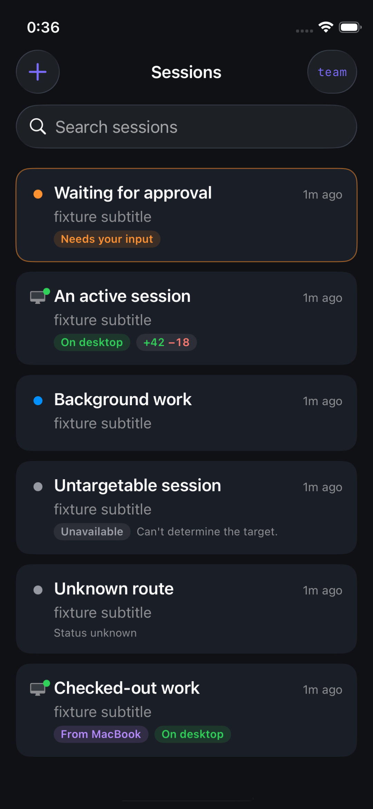
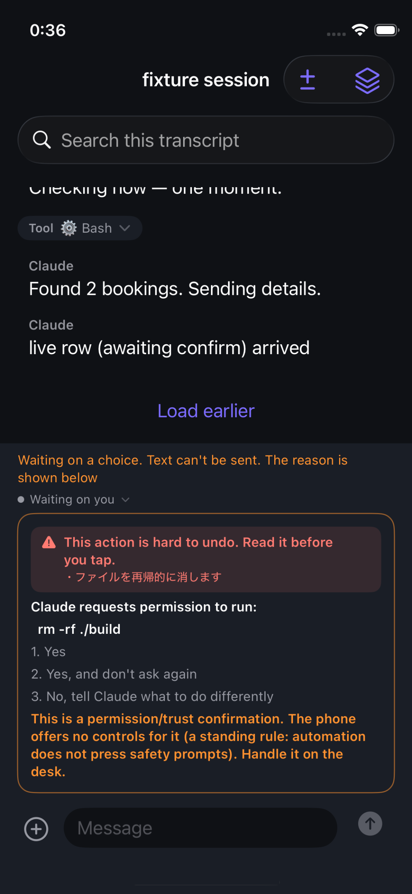

# RemoteMini

An iPhone app for running Claude Code sessions on a Mac at home from a phone:
see which session needs you, read its transcript and working-tree diff, reply,
and start new sessions. The phone talks to a small Node server (`rc-backend/`)
beside Claude Code on the Mac, reachable only over a Tailscale tailnet.

  
  

iOS Simulator screenshots, 2026-09-07, captured headlessly with `xcrun simctl`
(`ios/tools/shots.sh`) from the app's built-in test fixtures, so no real session
data. Right: the phone shows Claude's permission prompt but gives no button for
it, by design; safety prompts are answered at the Mac.

It is a single-user tool: one Mac, one phone, an ad-hoc OTA install, no installer.
Running it needs a Mac with Claude Code, Tailscale, Node, and Xcode with XcodeGen.
The part meant for reuse is the **harness**: every gate in the commit chain has a
control script that breaks the code on purpose and fails if the gate stays green.

The hard part was making the checks trustworthy. A broken gate looks the same as a
passing one. One control showed that if the gate selector crashed, 8 of the 11 commit
gates were skipped and the commit still succeeded; that case now stops the commit.

## Layout

| Path | What it is |
|---|---|
| `ios/` | SwiftUI iPhone app (XcodeGen project, unit + UI tests) |
| `rc-backend/` | Node desk: session list, transcript digest, working-tree diff, OTA hosting |
| `rc-backend/tools/` | The harness: pre-commit gate chain, deploy and OTA scripts, PII checker |
| `rc-backend/test/` | Desk tests plus `*-controls.sh` negative controls for each gate |
| `research/` | Feature-parity notes against the native Remote Control experience |
| `.harness/` | Evidence per day, review logs, the redaction pipeline for this public copy |

## The harness, in one paragraph

Every commit runs a chain of gates (`rc-backend/tools/pre-commit-gates.sh`).
Each gate has a matching *control*: a script that mutates the code or the
docs in a way the gate must catch, and fails the build if the gate stays
green. So the question asked of every gate is not "does it pass" but "can it
still fail". Line references in Markdown are ratcheted against real files,
cited test names must exist, evidence files must name what ran, and mutation
targets must be killed by the test suite. Production effect (deploying the
desk, cutting an OTA build) only happens through scripts that observe live
state first and leave a verifier artifact behind.

## Two repositories

The raw history lives in a private repository. This public one is a derived
copy: `.harness/publish-public.sh` clones the raw repo into a sandbox,
rewrites the whole history with `git filter-repo --replace-text`, runs the
PII checker and a secret sweep over tree and history, and pushes only if
both are clean. Hostnames, tailnet addresses, e-mail addresses, a client's
name and a family reference are replaced with placeholders, so a few
fixtures and log excerpts show values like `desk.tailnet.example`.

## Status

This is a personal tool, built in the open. It is not packaged for other
people yet: there is no installer, the docs are mostly Japanese, and the
iOS app is distributed to one phone by ad-hoc OTA. What is meant to be
reusable is the **harness**: the way changes are gated, verified and shipped.

## License

MIT. See `LICENSE`.
